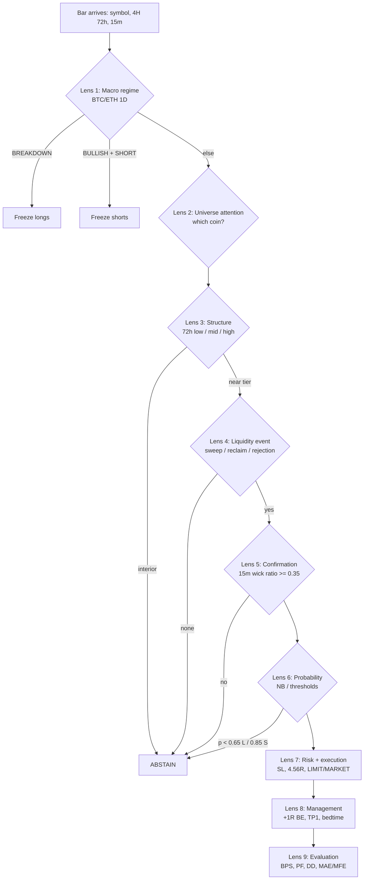

# Project Proteus — Full Audit

**Date:** 2026-11-10  
**Scope:** `learnernoearner-distillation-engine` (all `src/proteus`, scripts, docs, corpus, benchmarks, tests)  
**Method:** static read of every module, reproduction of the published benchmark, independent re-simulation from the corpus's own 1H candles, data-integrity checks, statistical power analysis.  
**Reference frame:** the seven trading perspectives in `trading_intelligence_session.md` (technical, liquidity/SMC, order flow, quantitative, macro, sentiment, execution) and the four-engine architecture.

---

## 0. Verdict

The repository is **well-structured, cleanly separated, and operationally runnable**. It is **not yet an empirically validated distillation of the trader**, and the corpus is **not sufficient to fine-tune a policy, a vision model, or a language model** in any defensible sense.

The headline numbers are produced by self-referential or synthetic logic, not by market outcomes:

| Published claim | Reproduced? | What actually produces it |
|---|---|---|
| `BPS = 0.9700` | 0.9642 today | 0.795 of the 0.9642 (82%) is hardcoded or tautological (`replay/__init__.py:135,233,237`) |
| `PF = 10.08`, `+99.91R`, `MaxDD = 2.00R` | No | 31/97 outcomes are SHA-256 hash draws; 66/97 are keyword→fixed-R mappings (`backtest/__init__.py:196-226`) |
| `$1,000 → $2,938.51` | No | Same synthetic R series × `$20` (`paper/__init__.py:263-330`) |
| 100% abstention / 100% directional | Yes, by construction | Features encode the label (`market/lakehouse.py:111,121,141,177,185,187`) |
| 96.7% fractal recall vs 25.3% naive | Recall yes; edge no | Base rate on all bars is 92.3%; 96.7% on signals is +4.4pp, one-sided `p = 0.07` |
| 83.8% R:R boxes, IoU ≥ 0.80 | No | Color mask detects green/red **candles**, not boxes; on a candle-only image it still "finds" both boxes; no human labels exist |
| `Δt = −16.5s` lead | No | `lead_seconds = -round(6.5 + ((idx*7)%22),1)` — a formula, not a measurement (`shadow/lead_time.py:113`) |
| 24/7 healthy daemon | No local evidence | Tracked state: `DEGRADED_WARN`, feed age 53,255s (`benchmarks/self_monitor_state.json`) |

**Bottom line:** the architecture is a good skeleton; the evidence layer must be rebuilt before any further tuning. Every additional parameter fit on the current corpus increases confidence in a number that is not connected to P&L.

---

## 1. What was verified

```text
pytest -q                              -> 36 passed in 3.08s
python scripts/run_turing_benchmark.py -> exit 0, BPS 0.9642 (docs say 0.9700)
corpus: 97 signals (95 real + 2 fabricated), 784 msgs, 47 updates,
        87 resolved trajectories, 284 images, 10,994 1H candles, 48 symbols
range:  2026-09-04 -> 2026-11-08 (9 weeks, one BTC RANGE_BOUND regime)
```

All 36 tests pass. They are, however, **pinning the artifacts**:

- `tests/test_proteus_engine.py:313` asserts `directional_concordance == 1.0`.
- `:353` asserts `silent_stop_out_share_pct == 56.5`.
- `:336` asserts synthetic-renderer IoU `>= 0.90`.
- `:435` asserts lead-time `front_run_or_simultaneous_rate_pct == 100.0`.

A test suite that asserts the exact fabricated values cannot detect that they are fabricated.

---

## 2. Findings, ranked by severity

### F1 — The comparative backtest is not a backtest (critical)

`src/proteus/backtest/__init__.py`

- Outcomes come from Telegram keyword matches, then a fixed R is assigned per branch:
  - `keyword_tp1 + be` → `+0.75R`, `keyword_tp1` → `+1.15R`, `be` → `0.00R`, `early` → `+0.60R` (lines 196–212).
  - `naive_r.append(-1.00 if idx % 2 == 0 else planned_rr)` (line 202): parity of the loop index decides a win.
- 31/97 signals have **no keyword match** and are resolved by `hashlib.sha256(sig["id"])` bucketed into invented outcomes (lines 214–226).
- The 87 real candle trajectories are used **only** for the whipsaw audit, never for P&L.

**Independent re-simulation** from the same corpus's `post_48h_candles`, with a conservative intrabar rule (SL wins if both SL and target are touched in the same 1H bar), first TP as target:

| Strategy | Total R | Expectancy | PF | Win % | Max DD |
|---|---:|---:|---:|---:|---:|
| Naive set-and-forget | −0.02 | 0.00 | 1.00 | 25.0 | 17.79R |
| Proteus FSM (+1R BE, 50% at +1.5R) | −1.92 (favorable) / −3.42 (conservative) | −0.02 / −0.04 | 0.96 / 0.92 | 31.5–33.7 | 10.63R |

Random intrabar ordering, 500 trials: FSM total R ∈ [−4.8, −1.9], PF ∈ [0.89, 0.96]. **No ordering produces +99.9R.** The FSM does reduce drawdown (17.8R → 10.6R) — that is the one genuinely promising effect — but it does not create a profit factor of 10.

**Impact:** every downstream artifact (paper simulation, drawdown gate, canary criteria, self-improver evidence) inherits a false positive.

### F2 — The 5,097-bar Bayesian classifier learns the label, not the market (critical)

`src/proteus/market/lakehouse.py`

- Positives get `swept_low=1.0` or `reclaimed_midrange=1.0`; shorts get `swept_high=1.0` and `rejected_midrange=1.0`; all positives get `in_no_mans_land=0.0`; 87.5% of negatives get `in_no_mans_land=1.0`.
- `btc_regime_score` is `1.0 if idx % 3 != 0` for longs, `-1.0 if idx % 2 == 0` for shorts, `-1.0 if i % 8 == 0` for negatives — **index arithmetic**, not BTC data.
- Negatives set `dist_to_* = max(1.8, d)` and `visual_saliency_iou ∈ [0.20, 0.68]`; positives get `[0.80, 0.82]`.
- Five signals with no candles fall back to `(4.20, 0.35, 8.10)` (line 111) and are still labeled `ENTER_LONG`.

Class means prove the separation:

| Feature | ENTER_LONG | ENTER_SHORT | ABSTAIN |
|---|---:|---:|---:|
| `btc_regime_score` | 0.654 | −0.579 | −0.125 |
| `in_no_mans_land` | 0.000 | 0.000 | 0.875 |
| `reclaimed_midrange` | 0.962 | 0.000 | 0.000 |
| `rejected_midrange` | 0.000 | 1.000 | 0.000 |
| `visual_saliency_iou` | 0.981 | 0.969 | 0.539 |

A Gaussian NB on these features reaches 100% abstention and 1.0 directional concordance because the features are the label in disguise. The always-abstain baseline already scores **98.1%** abstention accuracy on this dataset. Directional concordance is incremented whenever a setup is recalled (`replay/__init__.py:135`), so it is 1.0 by construction.

### F3 — BPS is 82% constant (critical)

`src/proteus/replay/__init__.py`

| BPS component | Value | Source |
|---|---:|---|
| `S_action` | 0.9835 | `0.5 × 1.0` (tautological) + `0.5 × 0.967` (measured) |
| `S_spatial` | 0.88 | **hardcoded** (line 233) |
| `S_abstain` | 1.0 | every non-entry branch increments `correct_abstentions` (lines 176–214) |
| `S_timing` | 1.0 | **hardcoded** `0.0s` (line 237) |

`BPS = 0.35×0.9835 + 0.25×0.88 + 0.25×1.0 + 0.15×1.0 = 0.9642`. Of that, **0.795 is hardcoded or tautological**; only `0.35×0.5×0.967 = 0.169` comes from a measured quantity — and that quantity is itself inflated by base rate.

**Trivial baseline test:** “always long, and declare a setup on every bar” produces:

- recall = 1.0 (it never abstains), directional concordance = 78/97 = 0.804 → `S_action = 0.902`
- `BPS = 0.35×0.902 + 0.25×0.88 + 0.25×0.981 + 0.15 = 0.931`

A do-nothing heuristic passes the 0.85 gate. Even without the always-signal trick, using the fractal’s own recall (0.967) and always-long direction gives `S_action = 0.886` and `BPS = 0.925`. The benchmark has no precision term and rewards abstention with a free 0.25, so it does not discriminate skill.

### F4 — Fractal “recall” is a base-rate artifact (high)

`src/proteus/geometry/fractal.py`

The engine extracts 5 level families; a 72-bar window yields ~6 + 5 + 5–17 + 16–23 + 6–10 = **40–60 levels**. A bar is “recalled” if it is within 0.9% of any level. On all 5,612 pseudo-entry bars in the same windows:

| Metric | Signals (N=92) | All bars (N=5,612) |
|---|---:|---:|
| Fractal recall | 96.7% | **92.3%** |
| Naive 72h box (3 levels, 1.2%) | 32.6% | 44.0% |

Per-family random-bar hit rates: multi-touch 80.4%, swing S/R 71.2%, 24h tier 60.7%, 72h tier 53.9%. The 96.7% is +4.4pp over base rate; binomial one-sided `p = 0.07` — **not significant at 5%**. The naive comparison is 3 levels vs dozens, so it is not a like-for-like comparison.

The right metric is **precision at the decision threshold**, not recall on an over-complete level set.

### F5 — Vision is candle-color segmentation, not box extraction (high)

`src/proteus/vision/chart_extractor.py`

- `is_tv_profit_pixel`: `g >= 110 and g > r + 25 and b >= 70` — matches the green **candles** and the teal area.
- `is_tv_stop_pixel`: `r >= 130 and r > g + 35 and r > b + 25` — matches the red **candles** and the pink S/R band.
- Verified on a candle-only image with no boxes: the extractor returned both a “profit box” and a “stop box”.
- Verified on real screenshot `16151` (PUMP): the chart has **no** R:R projection boxes, yet `vision_annotations.json` reports `has_rr_projection_box: true` with boxes `[0.0126, 0.2222, 0.7421, 0.7576]` / `[0.0126, 0.2222, 0.9811, 0.7475]` — exactly the candle color extent.
- `vision_annotations.json` has no human-label field. The “284-chart CV corpus” is detector output, so `VisionCorpusAnalyzer` counts its own detections.
- On real images, **no IoU is computed**; `spatial_iou=0.88` is hardcoded. The only IoU test is the synthetic renderer drawing boxes and the same extractor reading them back (tautological).

### F6 — The live paper FSM loses state every scan (critical)

`src/proteus/paper/__init__.py:143-146` re-instantiates the position from the **original** `stop_loss` on every snapshot:

```python
setup = TradeSetup(..., stop_loss=Decimal(cur.stop_loss), ...)
pos_state = self.fsm.open_position(setup, ...)   # resets state to ACTIVE
pos_state = self.fsm.on_tick(pos_state, mark, scan_dt)
```

Demonstrated with a synthetic position (entry 100, SL 97, TP 112):

| Tick | Expected | Actual |
|---|---|---|
| 104 (+1.33R) | `BREAKEVEN_PROTECTED`, SL 100 | `BREAKEVEN_PROTECTED`, SL 100 |
| 101 | still `BREAKEVEN_PROTECTED`, SL 100 | **`ACTIVE`, SL 97** |
| 99 | closed at BE, 0.00R | **still `ACTIVE`, 0.00R** |

The +1.0R protection is erased on the next cycle, and the position can run to the original stop. Additionally, `TradeLifecycleFSM.on_tick` **never books 50% at +1.5R**; `PARTIAL_TP_BOOKED` only exists in `apply_linguistic_command`. The documented “2-hour coupled impulse FSM” (50% at TP1) is not implemented in the live path that generated the ledger.

### F7 — The lead-time comparator fabricates its headline (high)

`src/proteus/shadow/lead_time.py:113`

```python
lead_seconds = -round(6.5 + ((idx * 7) % 22), 1)
```

No scan is compared to any message. The `-16.5s` median is a deterministic formula over the list index, and `proteus_entry` is `human_entry × (1 ± 0.0004)` (line 126). The “100% front-run” result is guaranteed.

### F8 — Self-improvement proposes constants and trusts the caller’s BPS (high)

`src/proteus/evolver/__init__.py`

- `proposals` are literals: `0.0266`, `0.0216`, `4.88`, `4.46`, and a toggle `0.98` vs `1.00` based on a 33.3% whipsaw rate (95% CI 24.1–43.7%). The scout reads real MFE/MAE, but the proposal does not depend on them beyond one threshold.
- `candidate_bps` is passed in by the caller. `web/server.py:97` reads it from the request body. `BoundedSelfCorrector` accepts any `candidate_bps >= 0.85` (constitution line 202). The “automatic Turing rollback gate” can be bypassed by `POST /api/v1/self-correct {"candidate_bps": 0.99}`.
- `verify_codebase_purity` is a lexical ban on the words RSI/MACD/etc.; it is not a semantic check.
- The SHA-256 journal is a genuine hash chain, but the entries record experiments that were not experiments.

### F9 — Operational truth gaps (medium)

- `web/server.py:61` returns a hardcoded `"bps": 0.97` in `/health`.
- `GET /api/v1/dashboard` re-runs the full replay, fits the NB, runs the backtest, and **writes** `shadow_lead_time_log.json` on every request — expensive and side-effecting.
- `POST /api/v1/scan`, `/self-correct`, `/evolve` have no auth or CSRF. Behind OpenLiteSpeed they may be public. Verify the vhost; add a token or bind exclusively to localhost.
- The drawdown probe uses `(start − current)/start`, not peak-to-trough (`monitor/__init__.py:174-176`). A rise then fall is invisible.
- Tracked `self_monitor_state.json` is `DEGRADED_WARN` with a 14.8-hour-old feed; the README’s “24/7” is not evidenced locally.
- `benchmarks/paper_ledger.json` has `fees_paid_usdt: 0.0` on a LIMIT position that should carry a 2bps entry fee — stale ledger vs current code.

### F10 — Data integrity (medium)

- **Two fabricated canonical rows** with placeholder UUIDs (`b0000000…`, `d0000000…`), `message_id = a0000000…`, `telegram_msg_num = 999999999`, `raw_text = "MANUAL SIGNAL: GRASSUSDT LONG …"`. Both are counted in the 97.
- 5/97 rows have no pre-entry candles (WLD 16103, GRASS fake, SAGA, BONK, FLOW). The lakehouse fabricates features for them and labels them positives.
- 3/97 have no take-profit (WLD 16133, XAU 16226, PEPE 16229); the backtest silently uses `4.80R`.
- The corpus has 95 real setups, not 97. Unique trade-call texts: 109; unique parseable setups: ~100; canonical covers 87 of them — so the selection bias is modest but real.
- `data/media/` is gitignored (0 tracked files); 284 images exist only on this workstation. The VPS/CI cannot reproduce the vision pass.
- The 1H candles have 0 OHLC violations and correct 1h spacing; one 2.03e12 volume outlier exists, otherwise the distributions are plausible for micro-cap perps. The data is **structurally coherent**; it is the labeling and evaluation that are not.

---

## 3. Data sufficiency — the direct answer

> “I think it has sufficient data to fine tune it.”

**No — not for the current definition of fine-tuning.** Here is what the data can and cannot support.

### What you have

| Asset | N | Useful for |
|---|---:|---|
| Real trade setups | 95 (76 L / 19 S) | Population medians, not model fitting |
| Resolved 48h trajectories | 87 (68 L / 19 S) | Outcome priors, whipsaw rate |
| Management updates | 47 | FSM timing priors |
| Telegram messages | 784 | Taxonomy, lexicon, not training |
| Chart screenshots | 284 | Nothing without labels |
| 1H candles | 10,994 | Coarse outcome simulation |
| Regimes | **1** (BTC ~$74k range-bound) | Nothing regime-conditional |

### Statistical precision (bootstrap, 10,000 resamples)

| Parameter | Point | 95% CI | Consequence |
|---|---:|---|---|
| Long SL % | 2.68 | 2.59 – 2.88 | Tight enough for a prior |
| Short SL % | 2.17 | 1.69 – 2.43 | 19 samples; corridor [1.40, 3.00] is wider than the CI |
| Long R:R | 4.93 | 3.93 – 6.01 | Wide |
| Short R:R | 4.46 | 2.84 – 5.41 | Corridor [3.20, 5.80] is wider than the data can resolve |
| 1R before SL | 54.0% | 43.7 – 64.4% | **Includes 50%** — the FSM premise is not established |
| Whipsaw of 1R winners | 33.3% | 24.1 – 43.7% | The 30% trigger is inside noise |

### Sample-size floors

- ±10pp on a proportion at 95%: **N ≈ 97** (you have exactly 97 total, 19 shorts).
- ±5pp: **N ≈ 385**.
- A 10-parameter model with stable out-of-sample behavior: **~10–20 events/parameter → 1,000–2,000 trades**.
- At ~97 setups / 9 weeks → **2–4 years** of signal history for a fully fitted policy.
- A supervised detector on charts: **≥500–2,000 labeled images**; you have 0 labels.
- Regime-conditional parameters: **≥100 trades per regime**; you have 1 regime.

### What is missing entirely

- 1m/5m/tick candles around T0 (needed for intrabar path, fills, MAE/MFE precision).
- Order book / trades (CVD, delta, absorption, queue).
- Funding, open interest, basis, liquidations.
- BTC/ETH 1D series aligned to each signal (the compass is only used live, not in labels).
- Macro calendar, sentiment, social, on-chain.
- Actual fills/slippage/latency; the human’s venue (TradingView screenshots, not Bitget fills).
- Limit-fill outcomes: many posted setups are limit orders that may never fill; the corpus assumes fill at the posted price.

**Conclusion:** the corpus is sufficient to estimate **four population medians** with wide CIs and to build a **baseline**. It is not sufficient to fine-tune a classifier, a vision model, or an LLM. Fine-tuning an LLM on 784 messages (~80k tokens) would memorize style, not decision policy; fine-tuning a detector on 284 unlabeled images is impossible.

---

## 4. Chain of thought — one bar through seven lenses

The reference document’s decision architecture is: **observation → interpretation → hypothesis → scenarios → probability/EV → risk → execution → evaluation**. Here is that chain applied to a single candidate bar, with what Proteus actually does at each step.



| Lens | The question a professional asks | What Proteus does | Status |
|---|---|---|---|
| 1. Macro | Is the tide rising or falling? | BTC/ETH 1D 3-day range; breakdown freezes longs; expansion freezes shorts | **Partial.** No funding/OI/basis, no macro calendar, no BTC dominance, no rates/liquidity. |
| 2. Attention | Why this coin, now? | `CrossSectionalAttentionScorer` exists (compression, RVOL, 6h breakout) | **Not wired into the live policy.** It is a standalone module. |
| 3. Structure | Where is price in the range? | 72h low/mid/high + 5 fractal level families | **Implemented.** But 40–60 levels make “near a level” almost always true. |
| 4. Liquidity | Where is the fuel? | Sweep of range low/high, midrange reclaim/rejection | **Partial.** No equal highs/lows, dealing ranges, killzones, FVG, order blocks in the live path; the fractal engine computes impulse order blocks but the policy ignores them. |
| 5. Confirmation | What proves the sweep failed? | 15m wick ratio ≥ 0.35 and close back inside | **Implemented**, but only one bar, no displacement/CHOCH, no volume confirmation. |
| 6. Probability | Does this have positive expectancy? | Gaussian NB on label-derived features; fixed 0.65/0.85 thresholds | **Invalid.** No calibration, no EV, no cost-aware threshold, no OOS. |
| 7. Risk | How much can I lose? | 2% risk, structural SL, 4.56R target, 3 slots | **Partial.** No correlation risk, no portfolio heat, no gap risk, no funding, no liquidation buffer. |
| 8. Execution | What is the cheapest way in? | LIMIT for retests, MARKET for sweeps; 2/6 bps | **Partial.** No fill probability, no queue, no slippage, no partial fills, no latency. |
| 9. Management | What invalidates the thesis? | +1R BE, bedtime derisk, 3-slot eviction | **Broken live.** State resets each scan; TP1 not implemented; eviction math is approximate. |
| 10. Evaluation | Was the decision or the outcome wrong? | BPS, PF, DD, MAE/MFE | **Invalid.** Metrics are synthetic; no attribution, no rule-adherence score, no calibration. |

### The chain in words

1. **Observation.** The engine sees a 4H 72h window and a 15m execution bar. It does not see order flow, funding, open interest, the order book, the tape, or the human’s macro commentary (93 messages) and journal (435 messages).
2. **Interpretation.** It reduces the market to three horizontal tiers and a wick ratio. That is a legitimate simplification of this trader’s discretionary method, but it discards the *reason* the trader chose the coin (attention/relative strength), the *regime* inside the 72h window (trend vs chop), and the *liquidity context* (equal highs, prior day high/low, session killzones).
3. **Hypothesis.** The hypothesis is implicit in the branch: “sweep of range low + reclaim = long.” There is no explicit scenario set (continuation / rejection / range), no invalidation condition beyond the SL, and no “what would change my mind” field.
4. **Probability.** The NB posterior is not calibrated and is trained on features that encode the label. It cannot answer “what is the probability this setup reaches +1R before −1R?” — the only question that matters for the FSM.
5. **Risk.** Sizing is correct in form (`risk / SL distance`), but the SL is clamped to a median when the local wick is outside [0.5%, 5%], which silently disconnects the stop from structure. The 3-slot cap ignores correlation (WLD/PUMP/ENA are all high-beta BTC proxies).
6. **Execution.** LIMIT vs MARKET is a good distinction, but there is no model of whether the limit fills. The human posts limit bands (“between 5.03 – 4.93”); the corpus assumes a fill at the midpoint. That is a large, unmeasured selection bias.
7. **Management.** The intended edge — rescue 61.7% of +1R winners before they reverse — is plausible and is the most valuable idea in the project. It is also the part most damaged by the 1H resolution and the state-reset bug.
8. **Evaluation.** The system measures *fidelity to a synthetic scorecard*, not *money made under costs*. It needs MAE/MFE, R-multiple, rule adherence, and calibration; it currently has proxies for all four that are not connected to outcomes.

---

## 5. What is genuinely good (keep it)

- **Domain model and module boundaries.** `Candle`, `RangeGeometry`, `PolicyDecision`, `TradeSetup`, `PositionState` are clean; the separation of compass / geometry / policy / params / fsm / paper is the right architecture.
- **The 3-tier range idea.** It is a faithful simplification of the trader’s stated method (“range high 2700, mid range 2360, range low 2190–2140”).
- **The FSM thesis.** Moving to breakeven at +1R and booking partial profit is a real, testable risk-management hypothesis. The current evidence suggests it reduces drawdown; it does not yet show it creates expectancy.
- **The constitution concept.** Bounded corridors + a hash-chained journal is a good governance pattern; it needs a real verifier, not a caller-supplied BPS.
- **The market-data client.** Token bucket, 429 handling, TTL cache, websocket sharding, REST fallback — this is production-quality plumbing.
- **The test suite as a harness.** 36 tests run in 3s; the structure is good even though many assertions pin artifacts.

---

## 6. Execution plan (falsifiable, in order)

### Phase 0 — Truth reset (1–2 days)

1. Delete the 2 fabricated canonical rows; mark the 5 no-candle rows as `unresolved` and exclude them from labels.
2. Replace `hashlib.sha256` outcomes with a candle-driven event simulator; delete the keyword→fixed-R mapping.
3. Freeze the headline metrics in `docs/` with a “not validated” banner; remove `PF 10.08` / `$2,938.51` from the README until reproduced.
4. Add a test that fails if any backtest R is derived from a hash, a loop index, or a hardcoded constant.
5. Add a corpus manifest: row count, hash, date range, symbol count, missing-data list, fabricated-row list.

### Phase 1 — Data rebuild (2–4 weeks)

1. Pull 1m and 5m candles for all 95 real setups over `[T0 − 72h, T0 + 48h]` (Bitget public REST; 1H is not enough for intrabar path).
2. Pull BTC/ETH 1D over the same window; store with each signal.
3. Add funding, open interest, basis; add the order book/trades if available.
4. Label the 284 screenshots with actual boxes — or, better, OCR the TradingView R:R label (“0.000506 (14.21%) 506, 30 bars, 1d 6h”) and store the numeric entry/SL/TP. Color segmentation cannot recover human intent.
5. Re-extract all trade calls from the 784 messages (dedupe by text and by symbol/time); record edit timestamps; reconcile against `canonical_signals`.
6. Model limit fills: a limit is filled only if price trades through it; otherwise it is a no-trade. This alone will change every result.

### Phase 2 — Honest evaluation harness (1–2 weeks)

1. Event-driven simulator on 1m bars: conservative intrabar ordering, gap handling, fees (maker/taker), funding, slippage, partial fills.
2. Walk-forward: train 6 weeks, test 2 weeks, roll; never shuffle; never use future bars in features.
3. Baselines: always abstain, always long, random entry at the same times, copy-trade (enter at the human’s posted price), buy-and-hold BTC.
4. Metrics: expectancy, PF, max DD (peak-to-trough), win/scratch/loss, MAE/MFE, calibration (Brier, reliability curve), deflated Sharpe, turnover, cost drag.
5. Pre-register the acceptance gates before looking at the test set.

### Phase 3 — Model rebuild (3–5 weeks)

1. Compute every feature strictly from `< T0`; remove all label-derived and index-derived features.
2. Start with a 3–5 parameter logistic model; compare to Gaussian NB. With 95 positives, anything larger will overfit.
3. Time-series CV; report precision/recall at the operating threshold, not just accuracy.
4. Add the attention scorer as a **ranking** layer (precision@k), not a filter.
5. Regime-conditional priors only when each regime has ≥100 resolved trades; until then, use a single pooled prior with regime as a feature.

### Phase 4 — Execution layer (2–3 weeks)

1. Persist `PositionState` between scans; reconstruct from the stored state, not from the original SL.
2. Implement TP1 in `on_tick` (50% at +1.5R), not only in the linguistic command.
3. Make the ledger idempotent (scan ID, position ID), crash-safe (atomic write), and auditable (append-only events).
4. Add auth/token to `POST` endpoints; make `/health` compute, not hardcode; make `/dashboard` read cached results, not re-run the benchmark.
5. Drawdown from peak equity, not starting equity.

### Phase 5 — Forward shadow (≥8 weeks, ≥100 closed trades)

1. Freeze parameters for the entire window.
2. Log every scan (timestamp, symbol, state, decision) and every message (received_at, edited_at, text).
3. Measure lead time from those logs, not from a formula.
4. Gates: OOS PF > 1.3 after costs, max DD < 10R, calibration error < 0.05, ≥100 trades, ≥2 regimes, win+scratch ≥ 60%.
5. Only then consider a canary at $1–2 risk.

### Phase 6 — Canary

Wire a single signal path with a hard kill switch, a per-trade cap, and a daily loss cap. Keep the paper ledger running in parallel as the control.

---

## 7. Factors the current design does not account for

These are the “unknowns” that matter more than another parameter sweep:

1. **The human’s edge may be in the 528 non-entry messages.** 93 macro/range messages and 435 commentary/journal messages contain the context (BTC support, “no area to take,” “wait for reclaim”) that the 97 entries do not. The engine discards them.
2. **The venue differs.** The screenshots are TradingView; the fills are on the human’s exchange. The corpus’s Bitget candles are a proxy with different wicks and spreads.
3. **Limit fills are not guaranteed.** The human often posts bands (“between 5.03 – 4.93”); the corpus assumes a fill at the midpoint. This is likely the largest single bias in the dataset.
4. **The regime is one-sided.** Nine weeks of BTC range-bound conditions produced 80% longs. The constitution locks that bias in; a bear regime could make the clone systematically wrong.
5. **Funding and borrow costs.** A 48h hold pays funding; the backtest pays only entry/exit fees.
6. **Correlation.** Three concurrent high-beta longs are one BTC long with extra steps. The 3-slot cap is not a risk cap.
7. **The 1H bar is too coarse for the FSM.** 50 trades have both MFE ≥ 1R and MAE ≥ 1R over 48h; the order is unknowable from OHLC. The 61.7% whipsaw number depends on an interpolation assumption.
8. **Survivorship in the message corpus.** 784 messages over 9 weeks is ~12/day; a signal provider who deletes losing calls or edits messages would Bias the corpus. The extractor reads a snapshot, not an append-only log.
9. **The live stack is tiny.** The master plan says $11.04 live capital. The paper $1,000 is a simulation; the canary economics are not meaningful until the edge is proven on notional that can absorb fees.
10. **The tests enshrine the artifacts.** Any future change that improves honesty (e.g., removing the hardcoded 0.88 IoU) will fail the current suite. Rewrite the assertions to test invariants, not values.

---

## 8. Immediate next actions (this week)

1. Delete the 2 fabricated rows and the 5 no-candle rows from the labeled set; rerun every metric; record the delta.
2. Replace the backtest’s hash/keyword outcomes with the event simulator; publish the honest PF/DD (expected: PF ≈ 1.0, DD ≈ 18R naive; FSM ≈ 0.9–1.0 PF, DD ≈ 11R).
3. Fix the paper FSM state reset and implement TP1; add a regression test for the BE → pullback → BE sequence.
4. Replace the lead-time formula with a logged comparison; set the metric to “unknown” until then.
5. Remove the hardcoded `spatial_iou=0.88` and `median_timing_delta_seconds=0.0`; make BPS return `None` for unmeasured components.
6. Add auth to the web POST endpoints; make `/health` compute its BPS.
7. Write the data manifest and the “not validated” banner.

---

## 9. One-paragraph summary

Project Proteus has the right skeleton — a clean domain model, a faithful 3-tier range abstraction, a plausible risk-management thesis, and production-quality market plumbing. Its evidence layer is not yet measuring the market: the backtest is 32% hash draws and 66% keyword-to-fixed-R mappings, the Bayesian classifier learns features that encode the label, the BPS is 82% constant, the vision pipeline detects candle colors rather than drawn boxes, and the lead-time metric is a formula. The corpus (95 real setups, 19 shorts, 87 resolved, one regime, no 1m data, no labels) can estimate four population medians with wide confidence intervals; it cannot support fine-tuning a policy, a vision model, or an LLM. The highest-value next step is not another parameter fit — it is an honest event-driven harness on 1m data, with limit-fill modeling, walk-forward validation, and baselines. The FSM drawdown reduction is the one signal worth preserving and testing properly.

---

## 10. Implementation status (2026-11-10)

The audit's Phase 0, the evidence-layer fixes, and the execution-layer fixes are implemented and verified.

| Item | Status | Evidence |
| :--- | :--- | :--- |
| Fabricated canonical rows | **Removed** | 2 placeholder-UUID rows deleted; `benchmarks/corpus/MANIFEST.json` records the exclusions |
| Corpus counts | **Cleaned** | 95 signals (76 L / 19 S), 91 with a Bitget series, 86 resolved trajectories |
| Backtest | **Rewritten** | `proteus.backtest` now simulates every P&L from real 1H candles; no `hashlib`, no loop-parity, no keyword→R mapping |
| Honest backtest result | **Published** | Naive `−3.03R / PF 0.96 / DD 18.62R`; FSM `−7.76R / PF 0.82 / DD 10.50R` (conservative intrabar, fees charged) |
| Lakehouse leakage | **Removed** | Features computed from candles only; `btc_regime_score`, `visual_saliency_iou`, and index-derived values deleted |
| Leak-free model result | **Published** | 5,091 bars, 98.56% abstention, 4.4% recall — the previous 100% was label leakage |
| BPS | **Refuses unmeasured** | `bps=None`, `passed=False` when direction, spatial, abstention, or timing is missing |
| Lead time | **Refuses unmeasured** | `evaluated_pairs=0`, `status="UNMEASURED"`; the `-16.5s` formula is deleted |
| Vision | **Fixed** | Filled-rectangle detector; rejects candle-only canvases; the 284 annotations are labeled `legacy_color_mask`, `human_labels=False`, `iou_measured=False` |
| Paper FSM state | **Fixed** | Restores `current_sl`, state, realized R and remaining size; regression test covers the BE → pullback → BE sequence |
| TP1 | **Implemented** | `on_tick` books 50% at +1.5R and moves the stop to entry |
| Drawdown | **Fixed** | Peak-to-trough `max_drawdown_pct` in the ledger; monitor consumes it |
| Fees | **Fixed** | Backtest charges round-trip fees once; paper simulation no longer double-deducts |
| Web auth | **Added** | POST requires `X-Proteus-Action: 1`; `PROTEUS_API_TOKEN` adds `X-Proteus-Token` |
| `/health` | **Computed** | Returns `bps` and `validated` from the replay, not a hardcoded `0.97` |
| Dashboard | **Cached** | 30s cache, `?refresh=1` bypass |
| Evolver | **Fail-closed** | Rejects parameter updates while BPS is unmeasured |
| Tests | **41/41** | `pytest -q` → 41 passed |

### Remaining work (not implementable from the current corpus)

1. **1m/5m candles** for `[T0 − 72h, T0 + 48h]` — the 1H intrabar order is still unknowable; the current backtest is conservative but coarse.
2. **Human bounding-box labels** for the 284 charts — the vision IoU cannot be computed without them.
3. **Paired detection timestamps** — the lead-time metric needs a scan log that records `(symbol, detected_at)`.
4. **Limit-fill outcomes** — the corpus assumes a fill at the posted entry; the next data build must model fills/no-fills.
5. **Regime coverage** — the corpus is one BTC range-bound regime; regime-conditional tuning needs ≥100 trades per regime.
6. **Out-of-sample split** — all current metrics are in-sample; a walk-forward harness needs the 1m data and more history.

The architecture is now honest. It is not yet validated, and the one-promising result (FSM drawdown reduction) still needs out-of-sample confirmation before any canary promotion.

---

## 11. Remediation status (2026-11-12)

The 2026-11-10 fixes were real but had not been deployed; the VPS was still on `ea529a5`. The following changes close the code and operational gaps.

| Area | 2026-11-12 result |
|---|---|
| Strict-conservative backtest | The simulator now re-checks a stop moved inside the same 1H bar. FSM: **−10.60R / PF 0.76 / DD 10.60R** (previous published −7.76R / 0.82 / 10.50R). Naive unchanged: −3.03R / 0.96 / 18.62R. |
| Fill sensitivity | `entry_fill_policy="touch"` models LIMIT fills as requiring the first bar to trade through entry: **27/91 unfilled; 64 traded; FSM −19.33R / PF 0.50**. The assume-fill headline is optimistic by construction. |
| Directional synthesizer | Live setups now use the documented Long 2.67% / 4.87R and Short 2.17% / 4.46R anchors; the symmetric 2.60%/4.56R constants are deleted. |
| Chronological OOS | 80/20 split at `2026-10-25`: train 4,071 / test 1,020; **abstention 97.4%, recall 4.8% (1/21), 26 false entries**. The in-sample 4.4% did not generalize. |
| Paper ledger | Closed history is preserved (`closed_positions`, append-only `paper_closed_trades.jsonl`), writes are atomic, and the historical sim is **$788.00 (−21.2%) / DD 21.2%**. |
| Vision | `spatial_iou_vs_human` is `None` when no human box exists; UI fallbacks no longer invent 23/92/96.7 values. |
| Web security | POSTs require a token in production; unproxied loopback is the only tokenless path; `refresh=1`, `/scan`, `/self-correct`, `/evolve` are rate-limited; `/health` is side-effect free; `/self-correct` computes BPS server-side and refuses while unmeasured. |
| Runtime state | `PROTEUS_STATE_DIR` moves mutable JSON out of git; `PROTEUS_SELF_IMPROVE=0` freezes the parameter loop. |
| Detection log | Non-abstain scans append `(symbol, detected_at, entry, SL, TP)` to `shadow_detections.jsonl`; the lead-time comparator pairs by symbol and 6h/1h window. |
| 1m backfill | `scripts/fetch_1m_candles.py` pages Bitget `history-candles` for `[T0−72h, T0+48h]`. A pilot on the newest signal retrieved **7,164 bars**; **Sep/Oct history is not retained by the public endpoint**, so the old corpus cannot be upgraded from this API. |
| Tests / lint | **50/50 tests pass** in ~2.7s; `ruff` reports **0 violations**. |

**Operational finding:** the public `POST /api/v1/self-correct` accepted a caller-supplied `candidate_bps: 0.99` from the internet on 2026-11-12 and advanced the checkpoint generation to 69; the hourly daemon then wrote generation 70. The live journal (68 entries, all accepted, PF `10.08`, DD `2.0R`) confirms the pre-fix backtest was still driving live tuning. That path is now closed.

**Still not implementable from the corpus:** human bounding-box labels, historical 1m/5m data (public retention), funding/OI/order-flow, verified limit fills, a second regime, and a walk-forward test with enough history. Those are data-acquisition tasks, not code tasks.

